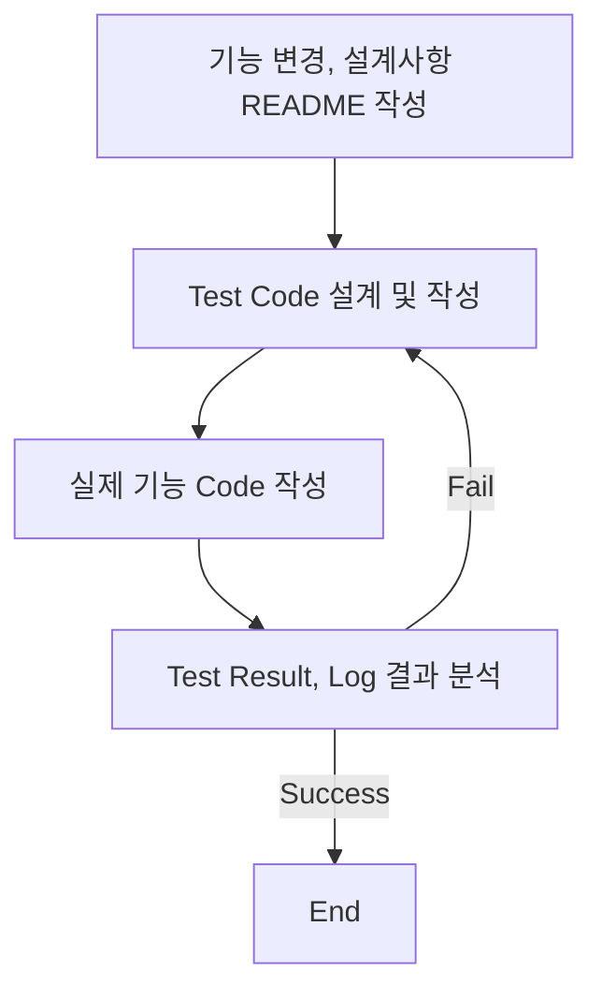
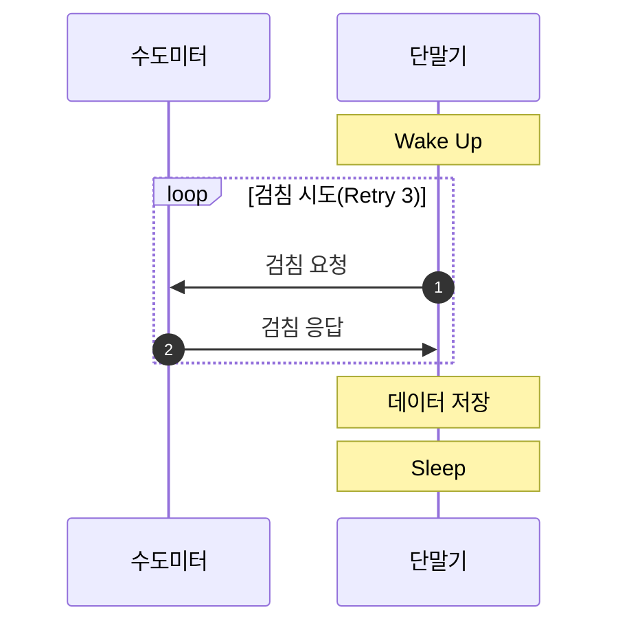
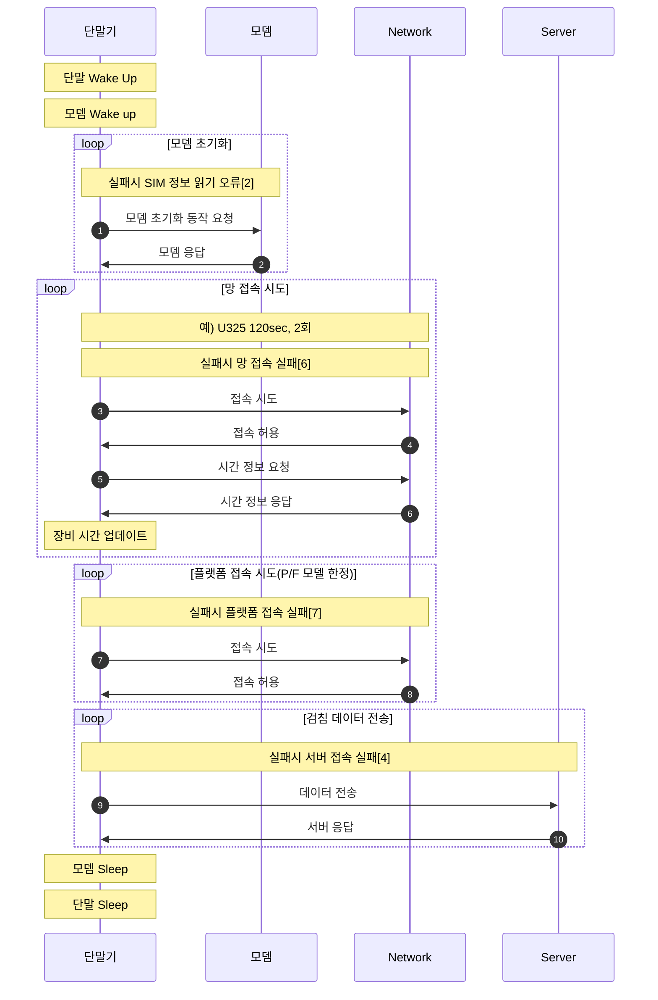

# 목차

<!-- TOC start -->

- [Intro](#Intro)
- [문서](#문서)
- [단말기 변경 이력](#단말기-변경-이력)

<!-- TOC end -->

# Intro

본 문서는 Firmware 품질 향상을 위한 TDD(Test Driven Development)의 일환으로 코드 변경사항 추적 문서화 기능을 담당한다.
단말의 기능 개발,변경 및 유지보수 등은 다음과 같은 순서로 작업한다.

## 단말 기본 동작 Flow

### 검침

### 통신

## Todo List

#### Main

- [x] Retry시 attch실패 -> certify실패 -> attach실패 무한 loop가 생길수 있음. 수정 필요

- [x] Flash Read시 쓰레기 데이터가 들어오는지 확인, 초기화하는 기능 추가 필요

- [x] 최종버전(U325) 현장 불량 검토 --> 신규 불량이 존재하는지?

  - [x] NFC 불량
  - [x] Flash 불량
  - [x] 통신 불량

- [x] 유선 펌웨어 업그레이드 기능 확인

  - [x] NB-IoT (UDP, P/F)
  - [x] LoRa SKT

- [x] AT+QLWULDATAEX 기능 추가, 테스트
- [x] 수자원 공사 보고주기 분할(최대 4일치) on/off 옵션 처리
  - 김영일 부장님 스마트폰 프로토콜 추가 필요
- [x] 일련 번호 시간 분산 테스트 이상없음
- [x] 보조중계기 P/F 버전 구현 / 테스트
  - [x] 강나루 대리 보조중계기 기능 Merge

#### Sub

- [x] 체크리스트 테스트[김용태 대리 작성]

# 문서

- [단말기 체크리스트](docs/테스트_체크리스트.xlsx) path:docs/테스트\_체크리스트

# 단말기 변경 이력

## NB-IoT

## LoRa

### LoRa SKT F/W 유선 업그레이드 Test (2022-03-03)

- [x] Test Ok

#### dataSkipMode LoRa 구조체에도 추가

### LoRa SKT Project 생성 (2022-03-03)
