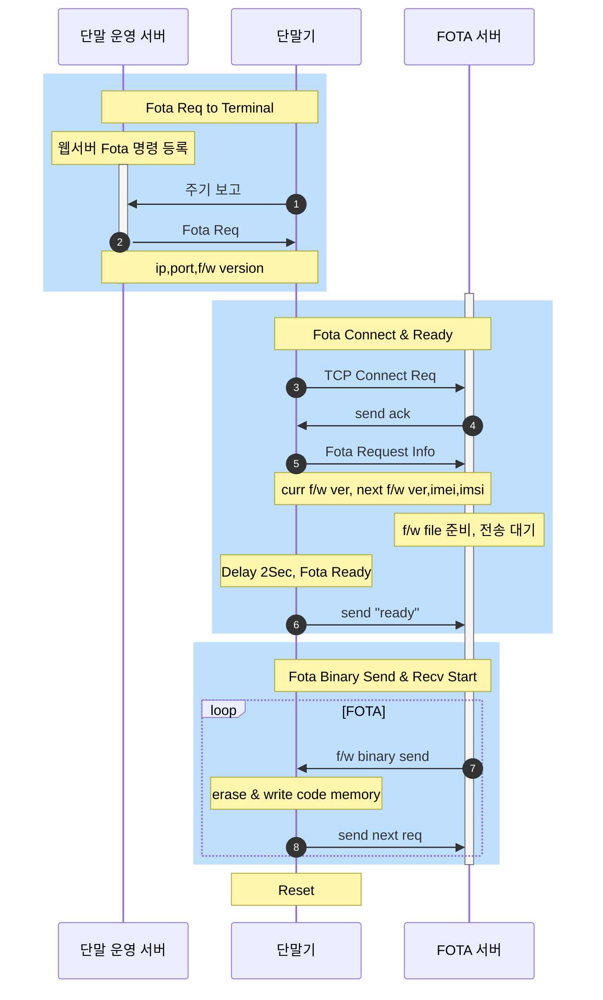
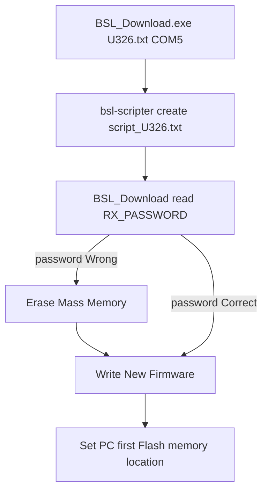
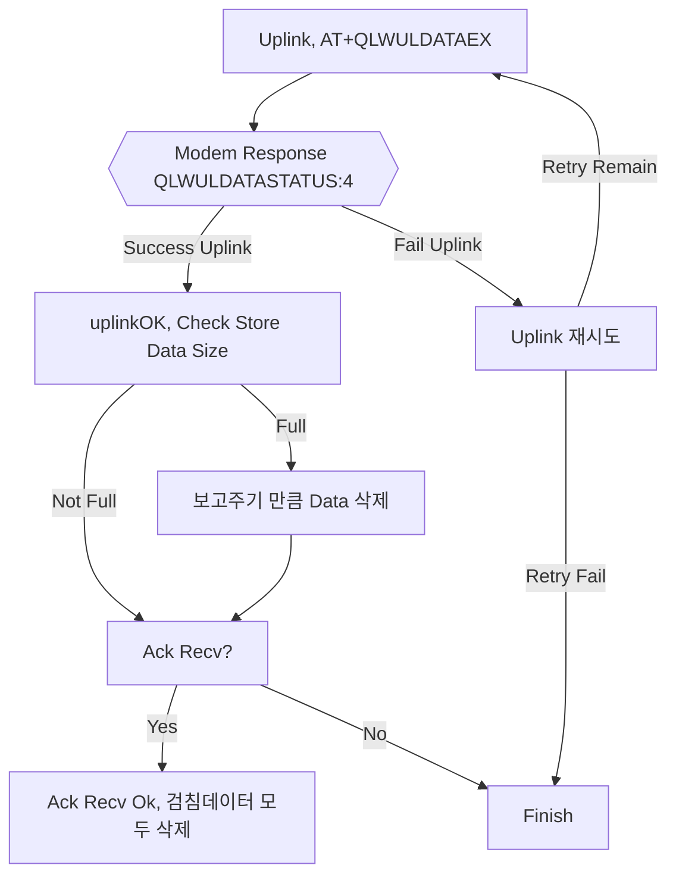

#### 기능 변경

<!-- TOC end -->

## U326 Release (2022-09-02)

#### modem boot check 변경

기존은 ..REBOOT_CAUSE_SECURITY_PMU_POWER_ON_RESET.. 를 파싱했으나 해당 메시지가 오지 않는경우 무한루프 발생. delay로 변경하고 at 커맨드로 확인

#### Timeout / Retry 변경

| Step                    | Timeout(기존->변경) | Retry(기존->변경) |
| ----------------------- | ------------------- | ----------------- |
| Attach                  | 120sec->150sec      | 1->2              |
| P/F Bootstrap, Register | X(90sec)            | 1->2              |
| Data Send               | 10sec -> 30sec      | 0->1              |
| Bip                     | 300sec -> 60sec     | X                 |

> Bip 원격개통을 하지 않으므로 시간 감소

#### dataFlash reboot 삭제 (2022-08-31)

필드에서 단말 리셋현상들이 발생하여 의미없는 reboot 코드 삭제

#### fota bug fix (2022-08-31)

fota send 확인시 rxdata를 지울경우 recv데이터가 날아가는 경우 발생.
fota send는 tcp로 송신 확인이 가능하므로 확인 절차 삭제

#### by lee dongwon(rudy) (2022-08-31)

##### port 검사 초기 한번만 하도록 변경 (2022-08-31)

bsl, lcd등 포트설정 검사시 초기 한번만 하고 이후는 메모리 저장정보로 사용

##### reed switch fix (2022-08-31)

reed switch를 output low설정시 전류소모 증가 발생. input always

##### adc port always input (2022-08-31)

기존은 adc 포트 사용후 output low로 변경하여 전압 측정시 오류 발생.
adc 포트를 alway input으로 설정

#### fota retry process 변경 (2022-05-26)

fota fail 감지시 동작

1. socket close
2. modem psm
3. rtc alarm set (every hour)
4. mcu lpm3
5. wakeup
6. retry fota

#### config checksum 추가 (2022-05-24)

- config 변수 추가
- checksum 확인 절차 추가
  - checksum fail시(초기 생산 물량) 0으로 init

#### lg p/f 접속 설정 auto로 변경 (2022-05-24)

- AT+QREGSWT 0->1 변경
- manual register 관련 코드 삭제.

아래와 같은 이유로 auto로 변경.

- manual로 하는것 보다 빠름.
- manual시 예외처리 코드 신뢰도 낮음

#### lg qa report no response (2022-05-24)

test중 lg qa report가 실패하는 경우 발생 아래와 같이 수정

- lg qa report의 고정 대기 시간 3~5초 가량 삭제. modem ok메시지 확인시 진행
- lg qa report는 실패하더라도 진행하도록 noresponse로 변경

#### retry process 변경 (2022-05-24)

기존은 각 STATE별로(attach, certify) retry 횟수가 다르고, 성공시 retry가 초기화 된다.  
이는 무한loop가 생성될 여지가 있으므로 전체 retry 초기화를 없애고 max retry를 1로(attach, certify, transfer 일 경우) 변경.

#### Delta Fota (2022-05-24)

무선 풀 업그레이드시 90Kb의 용량은 battery, nb-iot 제품에서는 실패 리스크, 배터리 부담, 긴 시간(3~10분 가량)때문에  
Delta 업그레이드 기능 추가. Fota 서버는 binary 파일에서 512byte단위로 차이점만을 생성하여 단말에 전달한다.
단말은 code 변경시 binary파일 변경을 최소화 하기 위해 파일별(.text & .const), 변수별(.data & .bss)로 메모리를 고정 분할 시킴.

#### Device Fota 개발 (인증용) (2022-04-20)

- [x] Fota 도중 실패시 복구 처리 추가 필요
  - Fota 실패시 modem psm->일정시간 대기->재접속->Fota

##### FOTA Flow



##### Fota Application Ram Code

MSP430F5419A는 XIP구조로 Runtime중에 Text, Const 메모리를 수정하면서 정상 동작이 불가능하다.  
따라서 Fota 동작시 구동되는 Application 영역은 따로 분리하여 Flash Memory save -> Run Ram의 구조로 되어야 한다.  
이는 ccs linker script를 통해 컴파일러에게 Fota Application 실행 영역인 Ram 주소를 전달하고 Bootloading 이후 첫 시작[main]에서 Fota Flash Code를 Ram영역으로 User가 복사해준다.

> ccs linker script는 Ram Code 복사 기능도 존재하지만 버그가 있어서 직접 복사로 한다.

Fota Application은 isr code, fota code, c library, modem 처리등이 포함된다

```
ram_code   0    00020000    00000a80     RUN ADDR = 00001c00
                  00020000    000000cc     uart.obj (.text:_isr:USCI_A2_ISR)
                  000200cc    000000b0     uart.obj (.text:_isr:USCI_A3_ISR)
                  0002017c    00000096     uart.obj (.text:_isr:USCI_A0_ISR)
                  00020212    00000096     uart.obj (.text:_isr:USCI_A1_ISR)
                  000202a8    00000088     osal_Timer.obj (.text:_isr:TIMER1_A0_ISR)
                  00020330    00000074     app.obj (.text:_isr:Port_1)
                  000203a4    0000006c     app.obj (.text:_isr:Port_2)
                  00020410    00000066     NFC_i2c.obj (.text:_isr:USCI_B3_ISR)
                  00020476    00000038     app.obj (.text:_isr:RTC_ISR)
                  000204ae    00000028     app.obj (.text:_isr:UNMI_ISR)
                  000204d6    00000008     rts430x_lc_ld_eabi.lib : isr_trap.asm.obj (.text:_isr:__TI_ISR_TRAP)
                  000204de    00000006     test.obj (.text:TEST_isTestMode)
                  000204e4    00000036     check_meter_misc.obj (.text:MISC_delayMs)
                  0002051a    00000014     flashDriver.obj (.text:ascii2BCD)
                  0002052e    00000036     flashDriver.obj (.text:ascii2Hex)
                  00020564    00000016     meter.obj (.text:std_checksum)
                  0002057a    00000012     rts430x_lc_ld_eabi.lib : strlen.c.obj (.text:strlen)
                  0002058c    0000003c                            : strstr.c.obj (.text:strstr)
                  000205c8    00000020                            : memset.c.obj (.text:memset)
                  000205e8    000001c8     fota.obj (.text:fotaRecv)
                  000207b0    0000006a     fota.obj (.text:writeCode)
                  0002081a    00000062     fota.obj (.text:fotaModemPrint)
                  0002087c    00000058     fota.obj (.text:eraseCode)
                  000208d4    00000034     fota.obj (.text:testatoi)
                  00020908    0000002e     fota.obj (.text:send)
                  00020936    0000001a     fota.obj (.text:modemRxClear)
                  00020950    00000018     fota.obj (.text:modemSend)
                  00020968    00000016     fota.obj (.text:startFota)
                  0002097e    00000014     fota.obj (.text:fotaPrint)
                  00020992    00000014     fota.obj (.text:fotaSend)
                  000209a6    0000000a     fota.obj (.text:checkFlashBusy)
                  000209b0    000000d0     fota.obj (.const:.string)

```

#### NB-IoT 통신 절차 개선 (2022-03-16)

##### 절차 변경

- P/F Register시 Fail이 자주 발생. Uplink 후 Deregister를 하도록 변경.
- 마지막 Retry는 Modem 종료후 2분뒤 시도하도록 변경

#### 최적화 기능 lv2 ON (2022-03-16)

delay 함수들 변수 volatile type 변경 (최적화 방지)

#### Interrupt Service Routine 에서 Interrupt Enable bit 조작시 MCU hang (2022-03-16)

NFC Service Routine 제외 bit 조작처리 삭제.
발생하더라도 sleep시 WDTHOLD를 하지 않게 수정 했으므로 1시간 뒤 복구 기대.

#### MSP430F5419A Errata(FLASH35) 적용. (2022-03-15)

특정 상황에서 Flash Read Error 발생하는 칩 버그

##### 발생 상황 시나리오

펌웨어에서 해당되는 사항들만 기록.  
해당 사항들은 MCU hang, Flash 깨짐 불량의 원인중 하나로 보임

###### Affected Devices

- MSP430F5419AIPZ
- MSP430F5419AIPZR
- MSP430F5419AIZQW
- MSP430F5419AIZQWR
- MSP430F5419AIZQWT

###### Affected Memory Location

- bank 0/2
- Info A/C
- BSL 0/2

###### Affected Flash Idle Time

Flash Access한 시간이 아래 상황의 Idle Time보다 길면 첫번째 Flash Access에서 발생 가능

> Flash Access Time은 Bank 각각으로 적용됨.
> example) Flash A Bank실행 200ms후 B Bank로 넘어가면 발생가능

| 온도[°C] | Idle Time Typical [ms] |
| -------- | ---------------------- |
| 30       | 15                     |
| 50       | 2                      |
| 85       | 0.5                    |

###### LPM Use

LPM 사용 후 실행된 ISR_VECTOR가 Flash Read Error로 잘못된 주소로 실행될 수 있음.

###### Flash Segment Erase

Flash Segment Erase시 기본적으로 23ms~32ms가 소모됨.  
Flash Idle Time을 넘으므로 Flash Read Error 발생 가능함

###### BSL Entry and Exit

BSL 진입, 퇴장시 발생 가능

##### Application Robustness

TI에서 제안한 방법은 아래에 적용하지만 불가능한 부분들이 존재.
불가능한 부분은 잘못된 code memory 접근시 무한루프 빠짐,  
따라서 WDT Time 16s->1h 8min으로 변경 & WDTHOLD를 하지 않는것으로 대처

- 대처 방안
  - [x] Vcore Level low
  - [x] ISR memory location above 0x8000
  - [x] Flash Erase시 asm코드(asm(" bis.w #0,R3 ");) 추가

##### See Detail Errata Sheet

[MSP430F5419A Microcontroller Errata (Rev. AC)](https://www.ti.com/lit/er/slaz282ac/slaz282ac.pdf?ts=1647223226855&ref_url=https%253A%252F%252Fwww.ti.com%252Fdocument-viewer%252FMSP430F5419A%252Fdatasheet%252FGUID-82181F47-3DE4-4ED4-9826-67BF00DB88C6)

[Flash Read Error and Susceptibility for MSP430F54xxA](https://www.ti.com/lit/an/slaa470/slaa470.pdf?ts=1647398329345&ref_url=https%253A%252F%252Fwww.google.com%252F)

#### Flash 불량(깨짐) 개선 (2022-03-14)

Flash Memory가 깨져 Server IP,Port, 서비스코드등이 부정확해져 통신실패가 발생하는 불량 개선.

- config_t, 설정 전역변수(RAM) NO_INIT Pragma
- FLASH Write Fail시 Reboot (x)
- FLASH Read Fail시 Server IP,Port,S/N, IMEI등의 정보는 초기화 하지 않음.
  - FLASH Read Ok시 이전과 동일하게 설정 전역변수 모두 Flash Data로 덮어씀.

#### free()하지 않는 malloc() 실패시 Reboot 추가 (2022-03-11)

일부 malloc()실패해도 Reboot되지 않는 부분 수정.

#### Flash Code Refactoring (2022-03-11)

- Flash Write 실패시 Reboot 삭제.
- Flash Busy시 printf 추가

#### 사용하지 않는 코드 삭제 (2022-03-11)

- app.c
  - APP_runPeriodicCheckNFC()
- MSP430FlashUtil.c
  - initFlash()
  - doneFlash()
- NFC_i2c.c
  - NFC_checkTagSetting()
- flashDriver.c
  - FLASH_readResetCause()

### BSL 기능 수정, 테스트 (2022-03-02)

펌웨어 쓰기는 정상 작동했으나 Set PC가 main()으로 jump하지 않아 자동으로 재실행되지 않는 문제 수정.  
Set PC는 bsl-scripter가 자동으로 FLASH 메모리의 첫번째 주소로 생성하는것으로 보이므로 main()함수를 FLASH 첫번째에 위치하도록 함.

- 수정사항

```c
file main.c

// main 메모리 section 생성.
#pragma CODE_SECTION(main, "MAIN")
main(){
...
}
```

```
file lnk_msp430f5419a.cmd

// MAIN 메모리 section을 FLASH 첫번째 주소에 강제 지정.
FLASHA : origin = 0x5C00, length = 0x0100
```

#### BSL 파일구조

| 파일명                             | 기능                             | Detail                                    |
| ---------------------------------- | -------------------------------- | ----------------------------------------- |
| bsl-scripter-windows.exe           | bsl script 생성 파일             | ti-txt 파일을 읽어 script 파일을 생성한다 |
| BSL_Download.exe                   | bsl script load & run            | script 파일을 읽어 bsl 과정을 진행        |
| \*.txt 예) U326.txt                | ti-txt 형식의 binary             | msp430에서 실행될 binary 파일             |
| script\_\*.txt 예) script_U326.txt | BSL_Download.exe가 실행할 script | bsl-scripter에 의해 매번 자동 생성된다    |



### IAR to CCS 변경 (2022-02-24)

NB Platform 단말, 보조중계기 프로젝트 생성

- [x] Test ok

#### 변경 사유

- Jtag Debug 기능 사용
- CCS는 무료버전으로 최신 업데이트 배포

#### 변경 사항

- IAR 종속적인 코드 변경
  - #pragma inline  
    → pragma func()
  - #pragma optimize = none  
    → 어차피 optimize 기능 끔
  - dataFlash.c 기능으로 변경된 linker정보변경 적용
    → FLASHC = length(0x5000) → 0x2330 으로 변경
  - RTCASMFunctions_IAR.s43파일 제거  
    → RTC read, set 모두 asm → c언어로 변경
  - md5, uuid 파일 library  
    → source file 변경

### LGU+ 품질리포트 Ver 1.75 (2022-02-11)

LGU+의 요청사항 (신규 제품의 NW 품질리포트는 변경된 버전으로 반영 필요.)

- 변경사항
  - [x] Msg Struct 변경
    - [x] Msg Version 1 -> 4
    - [x] FW 버전필드 (통신 모듈 버전 추가 필요)
      - [x] Length 20byte 변경
      - [x] Modem Firmware Version Add
    - [x] UE INFO 필드 추가
    - [x] PORT INFO 필드 추가, 0x000000
    - [x] Reserve 필드 추가, 0xF1F1F1

`malloc 사용을 회피하기 위해 20Byte 고정으로 함. format [len, Device Version/Modem Version(20byte)] 보다 길면 20byte 고정 크기만큼 입력. Modem Version String이 14보다 작더라도 msg size는 20이므로 공백 문자가 채워짐`

| No        | 항목        | Byte  | 항목 설명                        | 표기 방법                         | 변경 여부      |
| --------- | ----------- | ----- | -------------------------------- | --------------------------------- | -------------- |
| 1         | MSG Ver     | 1     | 리포트 메시지 버전(4)            | BCD                               | 1 -> 4         |
| 전원      | Unit        | 1     | 단말 전원 종류 및 전압           | 고정값(00,01,02)                  |                |
|           | Level       | 2     | 단말 배터리 전압                 | BCD                               |                |
| GCI       | Serving CID | 4     | Serving Cell ID                  | HEX                               |                |
| RF        | RSRP        | 2     | References Signal 수신 레벨(dBm) | BCD                               |                |
|           | SINR        | 2     | 신호대간섭비(dB)                 | 1byte(부호)+BCD                   |                |
| 모델명    |             | 1~21  | 단말 기종 정보                   | 1byte(Len) + N byte(ASCII)        |                |
| FW버전    |             | 1~21  | 단말,모뎀 버전 정보              | 1byte(Len) + Device Ver/Modem Ver | 모뎀 버전 추가 |
| TX POWER  |             | 2     | 단말의 송신 파워 레벨            | 1byte(부호) + BCD                 |                |
| 위치정보  | 위도,경도   | 1or11 | 자사 단말 미지원 1byte           | 0                                 |                |
| Neighbor  | Cell ID     | 1~13  | 자사 단말 미지원 1byte           | 0                                 |                |
| UE INFO   |             | 1     | UE 사용 BAND 및 설치 타입 정보   | 비트 패턴으로 표기                | 신규 추가      |
| PORT INFO |             | 3     | 자사단말 미지원                  | 0x00 0x00 0x00                    | 신규 추가      |
| Reserved  |             | 3     | 관리 필요한 추가항목을 위해 예약 | Hex = F1F1F1                      | 신규 추가      |

<!-- TOC --><a name="atqgmr-response-"></a>

### AT+QLWULDATAEX 기능 추가 (2022-01-25)

서울시 IS Tech 서버에서 과부하로 인해 특정 시간대(0~1시) 보고 단말기들에게 Ack를 못주는 현상 발생.
기존 단말의 기능에서 Ack를 받지 못하면 검침데이터가 쌓이게 되고 수자원 공사의 요구사항인 검침 데이터 4일치 보관이 겹쳐 Issue 발생.

AT+QLWULDATAEX는 데이터 Uplink시 LG Platform에 전송이 됐는지 확인이 가능. Platform Uplink가 확인되면 검침데이터를 삭제하도록 기능 변경.

<!-- TOC --><a name="flowchart"></a>

#### FlowChart


